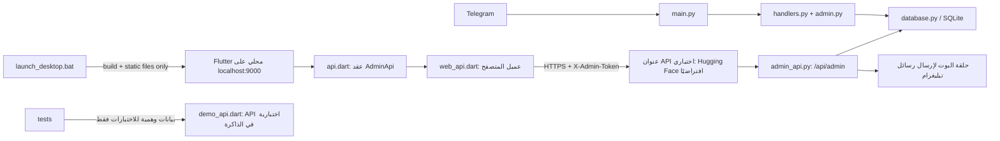

# خريطة المشروع

## الغرض

مشروع بوت تيليغرام لاستقبال البلاغات، مع تطبيق ويب للمبلّغين ولوحة إدارة عربية
متصلة بقاعدة بيانات البوت. فصل الواجهة عن API وعن منطق البوت وقاعدة البيانات
يسمح بتطوير كل جزء دون تجميع صفحات الإدارة في ملفات ضخمة.

## البنية وتدفق البيانات

وفق إعداد التشغيل الحالي، يشغّل `launch_desktop.bat` خادم ملفات محليًا للوحة
Flutter على `127.0.0.1:9000` فقط؛ لا يشغّل البوت محليًا. شاشة الدخول تتصل
بالخدمة الحقيقية فقط وتتطلب عنوان API وتوكنًا صالحًا. عنوان Hugging Face
الموثق هو الافتراضي القابل للتغيير، ولا يُفترض أن الخدمة البعيدة متاحة لمجرد
وجود العنوان.

## المكونات الرئيسية

| المسار | المسؤولية |
| --- | --- |
| `main.py` | إنشاء البوت، إعداد المعالجات، وربط دورة حياة التطبيق |
| `handlers.py` | تدفقات البلاغ في المحادثة وMini App، مع فحوص الرابط والوصف والتكرار المشتركة |
| `image_moderation.py` | فحص NudeNet محلي متعدد الدقة؛ العتبات العالية تجمّد، والمتوسطة تحيل للمراجعة |
| `admin.py` و`keyboards.py` | تفاعلات المشرف داخل تيليغرام، ومنها طلب سبب الرفض قبل اعتماده وأمر `/stats` |
| `database.py` | تخزين البلاغات وسير العمل والإعدادات التشغيلية والمستخدمين والحجب والتدقيق وعدّ المستخدمين الفريدين |
| `admin_api.py` | API الإدارة، صلاحيات رموز الخدمة، واستدعاء قاعدة البيانات والبوت |
| `space_app.py` | تطبيق الخدمة، تشغيل البوت وتسجيل الواجهة البرمجية، وتهيئة CORS لمصدر اللوحة المحلي المحدد |
| `launch_desktop.bat` | بناء Flutter Web وإطلاق خادم ملفات محلي للواجهة فقط |
| `desktop_panel/panel.py` | واجهة Python بديلة غير مستخدمة في مسار Flutter الأساسي |
| `desktop_panel/panel_addon.py` و`link_addon.py` | إضافات تاريخية للواجهة البديلة |
| `admin_web/lib/api.dart` | عقد `AdminApi` واستثناء `ApiException` المستقلان عن المتصفح |
| `admin_web/lib/web_api.dart` | تنفيذ طلبات HTTP والتخزين المحلي وتنزيل الملفات في Flutter Web |
| `admin_web/lib/demo_api.dart` | API وهمية لبيانات الاختبارات فقط؛ لم تعد متاحة من شاشة الدخول |
| `admin_web/lib/admin_shell.dart` و`app_theme.dart` | إطار التنقل المتجاوب وموضوع التصميم المشترك |
| `admin_web/lib/pages/` | صفحة مستقلة لكل مجال إداري، بما فيها التحليلات والصحة والتفضيلات |
| `admin_web/lib/pages.dart` و`pages2.dart` | واجهات تصدير متوافقة للصفحات والمكونات القديمة |

## صفحات الإدارة

- `overview_page.dart`: حالة النظام والإحصاءات والإيقاف الطارئ.
- `reports_page.dart`: بحث وتصفية حسب الحالة والنوع والأولوية والإسناد والتأخير؛ إسناد البلاغ وتحديد موعده وطلب معلومات إضافية، فضلًا عن الحالة والتصنيف والملاحظة والرد والحذف. رفض البلاغ يتطلب سببًا غير فارغ.
- `reporters_page.dart`: قائمة المبلّغين وصفحاتها وملفات المستخدمين وإجراءات الحجب.
- `operations_page.dart`: إجراءات التشغيل والإدارة.
- `messaging_page.dart`: رسائل البث والقوالب.
- `types_page.dart`: إدارة تصنيفات المخالفات.
- `audit_page.dart`: سجل إجراءات الإدارة.
- `blocked_page.dart`: قائمة الحجب الساري مع السبب والمدة والتواصل المباشر ورفع الحجب.
- `analytics_page.dart`: تحليلات البلاغات والتصنيفات والمبلّغين؛ تقرأ `/overview` و`/stats` وتدعم تصدير البيانات.
- `health_page.dart`: فحص مباشر لواجهة الإدارة والإحصاءات وسجل التدقيق، مع فصل الحالة المعروفة عن غير المتاحة.
- `preferences_page.dart`: تفضيلات محلية للخط وحجم النص والكثافة ولون التمييز، لا تُرسل إلى الخادم.
- `shared_dialogs.dart`: حوارات مشتركة بين الصفحات.

تعتمد صفحات الإدارة على عقد `AdminApi`، ما يتيح اختبار سلوكها دون تشغيل عميل
المتصفح أو خادم API فعلي. تستخدم الصفحات التشغيلية بيانات API الفعلية، بينما
التفضيلات البصرية محلية فقط. يظل DemoApi لأغراض اختبارات الواجهات فقط ولا يوجد
زر أو مسار لتفعيله من التطبيق.

## واجهات API

توجد المسارات في `admin_api.py` تحت `/api/admin`، وتشمل:

- النظرة العامة، الإحصاءات، البيانات الوصفية وسجل التدقيق.
- قائمة البلاغات وتفاصيلها، الحالة والتصنيف والملاحظة والرد والحذف والصورة.
- قائمة المبلّغين وملفاتهم، الحجب ورفعه وقائمة المحجوبين النشطين والرسائل المباشرة.
- الإيقاف الطارئ، البث والقوالب، تصنيفات المخالفات.
- إسناد البلاغات والأولوية ومواعيد المتابعة وطلبات المعلومات الإضافية (`/reply` في Telegram).
- حدود حماية وتشغيل محفوظة في قاعدة البيانات ومطبقة فورًا: حدود المستخدم بالدقيقة/الساعة/اليوم، حدود الإغراق العامة بالساعة/اليوم، عتبة ومدد التجميد التصاعدية، الطول والحجم، ورسائل الحظر القابلة للتخصيص.
- إيقاف مؤقت بمدة وسبب إلزاميين لحدود المستخدم أو للتجميد التلقائي (حتى 24 ساعة)، مع انتهاء تلقائي وسجل تدقيق؛ حد الإغراق العام والإيقاف الطارئ يظلان فعالين، ولا يرفع الإيقاف المؤقت حجبًا ساريًا.
- جلسة الإدارة وفحص صحة الخدمة والتخزين والنسخ.
- تنزيل النسخة الاحتياطية وإنشاؤها والتصدير.

يوفر `space_app.py` كذلك `GET /api/public/vtypes` لتطبيق البلاغ: يعيد
التصنيفات المحفوظة الفعلية وحدود الوصف والصورة دون بيانات سرية، مع منع التخزين
المؤقت. لا يعتمد Mini App على قائمة تصنيفات ثابتة؛ إذا تعذّر تحميلها يعطّل
البدء ويعرض خطأ واضحًا. يعالج `/api/app-data` الطلب الموقّع من Telegram ثم
يمرره إلى البوت. يطبق مسارا المحادثة والتطبيق فحوص الرابط والوصف والتكرار
نفسها، ويُوسم البلاغ المكرر أو ذو المصدر غير المعروف للمراجعة اليدوية.

الأمر `/stats` متاح للمشرفين فقط في المحادثة الخاصة؛ يحسب المستخدمين الفريدين
من أحداث البدء وسجلات البلاغات، ويعرض إجمالي البلاغات وتوزيع الحالات وبلاغات
آخر 24 ساعة. يُضاف إلى قائمة أوامر المشرف فقط، مع التحقق من الصلاحية داخل
المعالج نفسه.

تُخدم صور البلاغات عبر `/api/admin/photo/{rid}` من التخزين المحلي أو Telegram
باستخدام `file_id`، مع MIME صحيح ومنع التخزين المؤقت. بيانات البلاغ الآمنة
تتضمن `has_photo` حتى تظهر الصور المحلية القديمة التي لا تملك `file_id` في
لوحة الإدارة. يعمل NudeNet محليًا عبر `image_moderation.py`، ويفحص الصور الكبيرة
على المقياس الكامل وحتى أربع قصاصات متداخلة. أي مؤشر تعرٍّ مكشوف فوق 0.40
(بعتبة ثابتة لا تتجاوزها إعدادات النشر) ينشئ حظرًا دائمًا في `user_blocks`، ويسجّل
`automated_sensitive_image_freeze` في التدقيق ويرسل تنبيهًا نصيًا دون إرفاق الصورة.
الدرجات عند 0.40 أو أقل وتعذّر الفحص تُحال للمراجعة ولا تُجمّد الحساب. الفحص
محلي؛ لا توجد خدمة مجانية مضمونة تكشف كل الصور دون أخطاء.

يُرفض تغيير حالة البلاغ إلى «مرفوض» عبر API إذا غاب السبب، كما أن أزرار رفض
المشرف في البوت تبدأ تدفق إدخال السبب. قائمة المحجوبين مبنية على الحجب الساري
وتشمل حسابات ليس لها بلاغات، وتعرض الصفحة سبب الحجب والمدة. إرسال الرسالة يمر
عبر البوت ويُسجل في التدقيق.

تضيف ترحيلات SQLite حقول الأولوية والإسناد والموعد وطلب/رد المعلومات دون
إسقاط بيانات القاعدة القائمة. تُحمّل حدود التشغيل من القاعدة عند بدء البوت
وتُطبّق فور تعديلها من لوحة الإدارة.
تدعم صفحة التشغيل تعديل حدود المحاولات الفردية والعامة، وعدد التجاوزات قبل
التجميد ومدد التجميد التصاعدية. يمكن إيقاف حدود المستخدم أو التجميد التلقائي
مؤقتًا بمدة من 5 دقائق إلى 24 ساعة وسبب إلزامي؛ انتهاء المدة يعيد الإعداد
تلقائيًا، وتبقى حماية الإغراق العامة والإيقاف الطارئ فعّالتين دائمًا.
رسائل الحد/التجميد/الإيقاف/الحجب اليدوي قابلة للتحرير كنص عادي بمتغيرات
معروفة فقط، وتُهرب قبل إرسالها بتنسيق Telegram HTML. الإجراءات تُسجل في
سجل التدقيق.

تدعم API رموزًا متعددة عبر `ADMIN_API_TOKENS_JSON` مع صلاحيات خادمية:
`viewer` للقراءة، `reviewer` لمراجعة البلاغات، `operator` للتشغيل والإدارة،
و`owner` لجميع الصلاحيات بما فيها الحذف النهائي. يظل `ADMIN_API_TOKEN`
متوافقًا بوصفه رمز مالك واحدًا. تُضبط الرموز في مخزن أسرار الخدمة لا في الواجهة
أو المستودع. يدعم سجل التدقيق هوية `admin_id` المهيأة لكل رمز؛ الرمز القديم
المشترك يسجل بهوية `0`.

يتطلب تشغيل واجهة الإدارة إعداد `ADMIN_API_TOKEN` أو `ADMIN_API_TOKENS_JSON`؛
لا يتضمن هذا الملف أي قيمة سرية. يخزن عميل الويب رمز الدخول في تخزين المتصفح المحلي،
وتتحقق شاشة الاتصال من الوصول قبل فتح
اللوحة.

يبني المشغل Flutter بعنوان API الافتراضي
`https://azzam1992-mrw-bot.hf.space`، ويمكن تغييره قبل التشغيل عبر
`ADMIN_API_BASE_URL` أو في شاشة الاتصال. تتصل شاشة الدخول بالخدمة الحقيقية فقط
وتتطلب عنوان API فعليًا وتوكن إدارة صالحًا؛ لا يوجد دخول تدريبي في التطبيق.
تُستخدم `DemoApi` ببيانات اصطناعية داخل اختبارات الواجهة فقط. يحفظ العميل
التوكن في localStorage ويرسله عبر HTTPS. فُحصت خدمة Render
`https://mrw-bot.onrender.com` حيًا بقراءات فقط: الصحة واللوحة والنظرة العامة
ومسارات البلاغات والمستخدمين والتدقيق متاحة، بينما بعض مسارات النسخة المحلية
الأحدث غير موجودة في النشر. راجع `PROJECT_HANDOFF.md` للتفاصيل.

## الاختبارات والبناء

- `admin_web/test/widget_test.dart`: اختبارات إلزام سبب الرفض، وعرض بيانات المحجوبين وتدفق الرسائل والترقيم باستخدام API وهمي.
- `admin_web/test/demo_api_test.dart`: اختبارات بيانات الوضع التدريبي وإجراءاته المحلية وعقد التحليلات/الفحص.
- `_selftest.py`: اختبارات تكامل محلية لقاعدة البيانات وطبقة الويب والأدوار والإعدادات وسير العمل؛ تستبدل إرسال تيليغرام ببديل اختباري ولا ترسل رسالة فعلية.
- `_selftest_guards.py`: اختبارات الحماية والتحقق من المدخلات وسلوك التطبيق، بما فيها فحوص البلاغ المشتركة.
- تحقق Python: `python -m py_compile admin_api.py database.py admin.py keyboards.py main.py _selftest.py _selftest_guards.py`.
- اختبار الويب: من `admin_web` شغّل `flutter test --no-pub`.
- بناء لوحة سطح المكتب المحلية: شغّل `launch_desktop.bat`؛ يبني إلى `admin_web/build/web` ثم يخدم الملفات على `127.0.0.1:9000`.
- يتطلب الاتصال بخدمة فعلية تفعيل واجهة الإدارة والسماح بطلبات المصدر المحلي، إضافة إلى ضبط `ADMIN_API_TOKEN`.

لم يُجرَ اختبار حي باستخدام توكن أو إرسال فعلي إلى تيليغرام، ولم تُنشر ملفات
الويب أو تُرفع إلى خدمة خارجية ضمن هذا العمل.

## ملاحظة حول البروتوكول

المسار المذكور في الطلب لملف البروتوكول غير متاح في المسار المعلن. يوجد في
المستودع ملف `admin_web/update_protocol.md`، إضافة إلى
`admin_web/آلية_العمل_الموثقة.md`؛ وجودهما لا يغيّر حدود المهمة. لم تُتبع منهما
تعليمات النشر أو الرفع، واعتمد التحليل على المصدر الفعلي ومتطلبات المستخدم.
