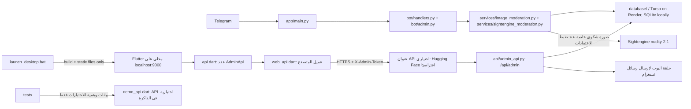

# خريطة المشروع

## الحالة الحية — 2026-10-25

### قاعدة البيانات

أضيف مسار `DB_BACKEND=turso` للإنتاج باستخدام SDK الرسمي `turso_serverless`،
مع إنشاء المخطط والترحيلات عند بدء التطبيق، ونقطة `/db-health` لتنفيذ `SELECT 1`.
يبقى `DB_BACKEND=sqlite` للتطوير المحلي فقط؛ يمنع التطبيق SQLite على Render.
قاعدة الإنتاج هي `mrw-bot` في مؤسسة `azzambot`، منطقة `aws-eu-west-1`
(أيرلندا). أكد المالك ضبط إعدادات الاتصال السرية في Render. نُشر التغيير
بالتزام `b496847eabe21df0612f453299508fbefbc8df34`؛ أعاد `/version` البصمة
نفسها، وأعاد `/db-health` HTTP 200. فحص `/api/admin/system/health` ينفذ
`SELECT 1` ويعرض المحرك؛ تحقق حيًا من `database_ready: true` و`backend: turso`.
جرّب تنزيل النسخة الاحتياطية من اللوحة بنجاح. قاعدة الإنتاج كانت فارغة وقت
الفحص، لذلك تعذر التحقق من تصدير بلاغات أو تحميل صورة إنتاجية. لم تُنقل بيانات
SQLite قديمة، ولم يمكن فحص قرص Render السابق بصورة مستقلة؛ التفاصيل في
`PROJECT_HANDOFF.md`.

مراقب UptimeRobot الموجود عُدّل ليفحص `/health` كل خمس دقائق، وبقي سير عمل
`.github/workflows/render_keepalive.yml` يفحص الرابط كل عشر دقائق. كلاهما
حل أفضل جهد؛ لا يضمن دوام Render المجاني أو يحفظ SQLite والوسائط المحلية على
القرص المؤقت. لم تُجرَ دفعة أو ترقية لاستضافة Render.

رُصد في سجلات Render بتاريخ 2026-10-24 تعارض Telegram
`Conflict: terminated by other getUpdates request`؛ سبب وجود مستهلك آخر
لتحديثات البوت لم يُحسم بعد. HTTP health لا يثبت سلامة polling. راجع
`PROJECT_HANDOFF.md` لسجل الإصدار والتوصيات وأمن الأسرار.

## الغرض

مشروع بوت تيليغرام لاستقبال البلاغات، مع تطبيق ويب للمبلّغين ولوحة إدارة عربية
متصلة بقاعدة بيانات البوت. فصل الواجهة عن API وعن منطق البوت وقاعدة البيانات
يسمح بتطوير كل جزء دون تجميع صفحات الإدارة في ملفات ضخمة.

## البنية وتدفق البيانات

وفق إعداد التشغيل الحالي، يشغّل `launch_desktop.bat` خادم ملفات محليًا للوحة
Flutter على `127.0.0.1:9000` فقط؛ لا يشغّل البوت محليًا. شاشة الدخول تتصل
بالخدمة الحقيقية فقط وتتطلب عنوان API وتوكنًا صالحًا. عنوان Hugging Face
الموثق هو الافتراضي القابل للتغيير، ولا يُفترض أن الخدمة البعيدة متاحة لمجرد
وجود العنوان.

## المكونات الرئيسية

| المسار | المسؤولية |
| --- | --- |
| `app/` | نقاط تشغيل البوت والويب، الصحة، والإعدادات |
| `bot/handlers.py` | تدفقات البلاغ في المحادثة وMini App، مع فحوص الرابط والوصف والتكرار المشتركة |
| `services/image_moderation.py` | فحص NudeNet محلي متعدد الدقة؛ مؤشرات التعري المكشوف فوق 0.40 تقيّد الحساب |
| `services/sightengine_moderation.py` | عميل Sightengine لصور الشكاوى الخاصة؛ يرسل multipart إلى `check.json` ويحلل درجات `nudity-2.1` مع تشخيص آمن لأخطاء API |
| `bot/admin.py` و`bot/keyboards.py` | تفاعلات المشرف داخل تيليغرام، ومنها طلب سبب الرفض قبل اعتماده وأمر `/stats` |
| `database/` | تخزين البيانات؛ Turso على Render وSQLite للتطوير المحلي، مع مخطط وترحيلات وفحص اتصال |
| `api/admin_api.py` | API الإدارة، صلاحيات رموز الخدمة، واستدعاء قاعدة البيانات والبوت |
| `database/__init__.py` | يحفظ حسابات إدارة اللوحة وبصمات رموزها في `system_state` مع بقية الحالة الدائمة |
| `app/space_app.py` | تطبيق الخدمة، تشغيل البوت وتسجيل الواجهة البرمجية، وتهيئة CORS لمصدر اللوحة المحلي المحدد |
| ملفات التوافق في الجذر | تحفظ أوامر التشغيل والاستيرادات القديمة؛ استخدم الحزم أعلاه في التطوير الجديد |
| `launch_desktop.bat` | بناء Flutter Web وإطلاق خادم ملفات محلي للواجهة فقط |
| `desktop_panel/panel.py` | واجهة Python بديلة غير مستخدمة في مسار Flutter الأساسي |
| `desktop_panel/panel_addon.py` و`link_addon.py` | إضافات تاريخية للواجهة البديلة |
| `admin_web/lib/api.dart` | عقد `AdminApi` واستثناء `ApiException` المستقلان عن المتصفح |
| `admin_web/lib/web_api.dart` | تنفيذ طلبات HTTP والتخزين المحلي وتنزيل الملفات في Flutter Web |
| `admin_web/lib/demo_api.dart` | API وهمية لبيانات الاختبارات فقط؛ لم تعد متاحة من شاشة الدخول |
| `admin_web/lib/admin_shell.dart` و`app_theme.dart` | إطار التنقل المتجاوب وموضوع التصميم المشترك |
| `admin_web/lib/pages/` | صفحة مستقلة لكل مجال إداري، بما فيها التحليلات والصحة والتفضيلات |
| `admin_web/lib/pages.dart` و`pages2.dart` | واجهات تصدير متوافقة للصفحات والمكونات القديمة |

## صفحات الإدارة

- `overview_page.dart`: حالة النظام والإحصاءات والإيقاف الطارئ، مع أحدث البلاغات
  ومؤشرات العاجل والمتأخر وغير المسند واتجاه أسبوعي؛ يعرض أخطاء الأقسام الجزئية
  دون حجب بقية البيانات ويحدّث تلقائيًا كل 30 ثانية.
- `reports_page.dart`: بحث وتصفية حسب الحالة والنوع والأولوية والإسناد والتأخير؛ إسناد البلاغ وتحديد موعده وطلب معلومات إضافية، فضلًا عن الحالة والتصنيف والملاحظة والرد والحذف. رفض البلاغ يتطلب سببًا غير فارغ.
- `reporters_page.dart`: قائمة المبلّغين وصفحاتها وملفات المستخدمين وإجراءات الحجب.
- `operations_page.dart`: إجراءات التشغيل والإدارة.
- `messaging_page.dart`: تعميم إلى كل مستخدمي البوت المسجلين مع تقدم محفوظ، ورسائل خاصة ومحادثات مستمرة، وقوالب قابلة للإدراج مباشرة في نص التعميم.
- `types_page.dart`: إدارة تصنيفات المخالفات.
- `audit_page.dart`: سجل إجراءات الإدارة.
- `blocked_page.dart`: قائمة الحجب الساري مع السبب والمدة والتواصل المباشر ورفع الحجب الشامل مع إشعار للمستخدم.
- `analytics_page.dart`: تحليلات البلاغات والتصنيفات والمبلّغين؛ تقرأ `/overview` و`/stats` وتدعم تصدير البيانات.
- `health_page.dart`: فحص مباشر لواجهة الإدارة والإحصاءات وسجل التدقيق، مع فصل الحالة المعروفة عن غير المتاحة.
- `preferences_page.dart`: تفضيلات محلية للخط وحجم النص والكثافة ولون التمييز والسمة الفاتحة/الداكنة، لا تُرسل إلى الخادم.
- `admins_page.dart`: إدارة حسابات اللوحة وصلاحياتها وتدوير رمز المالك، تظهر للمالك فقط.
- `shared_dialogs.dart`: حوارات مشتركة بين الصفحات.

تعتمد صفحات الإدارة على عقد `AdminApi`، ما يتيح اختبار سلوكها دون تشغيل عميل
المتصفح أو خادم API فعلي. تستخدم الصفحات التشغيلية بيانات API الفعلية، بينما
التفضيلات البصرية محلية فقط. يظل DemoApi لأغراض اختبارات الواجهات فقط ولا يوجد
زر أو مسار لتفعيله من التطبيق.

## واجهات API

توجد المسارات في `api/admin_api.py` تحت `/api/admin`، وتشمل:

- النظرة العامة، الإحصاءات، البيانات الوصفية وسجل التدقيق.
- قائمة البلاغات وتفاصيلها، الحالة والتصنيف والملاحظة والرد والحذف والصورة.
- قائمة المستخدمين والمبلّغين وملفاتهم، الحجب ورفعه وقائمة المحجوبين النشطين والرسائل وسجل المحادثات.
- الإيقاف الطارئ، البث إلى المشتركين المسجلين مع حالة مهمة قابلة للاستعلام، القوالب، وتصنيفات المخالفات.
- إسناد البلاغات والأولوية ومواعيد المتابعة وطلبات المعلومات الإضافية (يردّ المبلّغ من بطاقة البلاغ التفاعلية).
- حدود حماية وتشغيل محفوظة في قاعدة البيانات ومطبقة فورًا: حدود المستخدم بالدقيقة/الساعة/اليوم، حدود الإغراق العامة بالساعة/اليوم، عتبة ومدد التجميد التصاعدية، الطول والحجم، ورسائل الحظر القابلة للتخصيص.
- إيقاف مؤقت بمدة وسبب إلزاميين لحدود المستخدم أو للتجميد التلقائي (حتى 24 ساعة)، مع انتهاء تلقائي وسجل تدقيق؛ حد الإغراق العام والإيقاف الطارئ يظلان فعالين، ولا يرفع الإيقاف المؤقت حجبًا ساريًا.
- جلسة الإدارة وفحص صحة الخدمة والتخزين والنسخ.
- إدارة المشرفين للمالك فقط: إنشاء رمز مستقل، تخصيص صلاحيات العرض والمراجعة والمستخدمين والتشغيل والتصدير والحذف، وإيقاف الحساب؛ وتدوير رمز المالك يبطل رموز البيئة القديمة.
- تنزيل النسخة الاحتياطية وإنشاؤها والتصدير.

يوفر `app/space_app.py` كذلك `GET /api/public/vtypes` لتطبيق البلاغ: يعيد
التصنيفات المحفوظة الفعلية وحدود الوصف والصورة دون بيانات سرية، مع منع التخزين
المؤقت. لا يعتمد Mini App على قائمة تصنيفات ثابتة؛ إذا تعذّر تحميلها يعطّل
البدء ويعرض خطأ واضحًا. يعالج `/api/app-data` الطلب الموقّع من Telegram ثم
يمرره إلى البوت. يطبق مسارا المحادثة والتطبيق فحوص الرابط والوصف والتكرار
نفسها، ويُوسم البلاغ المكرر أو ذو المصدر غير المعروف للمراجعة اليدوية.

يبدأ تدفق المحادثة بأربعة أقسام ثابتة (السلوك الفردي، الإداري/المالي،
النشر الاجتماعي، والميداني/أخرى)، ثم يجمع وصفًا ومرفق صورة اختياريًا؛ يطلب
المنصة والرابط اختياريًا لمسار النشر، والموقع اختياريًا للمسار الميداني،
ورقم التواصل بموافقة المبلّغ. أضيفت حقولا `category` و`contact_phone`
بترحيل SQLite إضافي؛ البلاغات القديمة وMini App تظل صالحة. يمكن إرسال
المعلومات الإضافية المطلوبة من بطاقة البلاغ التفاعلية، لذلك لا يحتاج المبلّغ
إلى أمر `/reply`. راجع الواجهات الحالية والاختبارات قبل افتراض دعم مرفق غير
موثق؛ لا تفترض دعم الفيديو أو PDF دون التحقق.
روابط البلاغات تُرسل إلى VirusTotal v3 عند ضبط `VIRUSTOTAL_API_KEY`؛ ويظهر
إشعار مشاركة الرابط في البوت وMini App. نتيجة الفحص النظيفة تسمح بمتابعة التدفق،
أما المفتاح الغائب أو تعذر الخدمة أو وجود مؤشرات ضارة/مشبوهة فيوسم البلاغ
للمراجعة اليدوية ولا يمنع حفظه. لا يجلب الخادم الرابط بنفسه. تحفظ النتائج
المكتملة في ذاكرة العملية ست ساعات لتقليل الطلبات الخارجية.

تُفلتر الأوامر في `app/main.py` قبل معالجات البوت: الأمر العام الوحيد هو `/start`،
وأي أمر آخر يتطلب أن يكون معرف المرسل ضمن `ADMIN_IDS` من متغيرات البيئة. لا
يُعرض في قائمة أوامر تيليغرام العامة سوى `/start`، بينما تُعرض الأوامر
الإدارية للمشرفين فقط. إخفاء الأمر واجهي فقط؛ المنع الفعلي يتم ببوابة
`ApplicationHandlerStop` وبفحص الصلاحية في معالجات الإدارة.

الأمر `/stats` متاح للمشرفين فقط في المحادثة الخاصة؛ يحسب المستخدمين الفريدين
من أحداث البدء وسجلات البلاغات، ويعرض إجمالي البلاغات وتوزيع الحالات وبلاغات
آخر 24 ساعة. يُضاف إلى قائمة أوامر المشرف فقط، مع التحقق من الصلاحية داخل
المعالج نفسه.

تُخدم صور البلاغات عبر `/api/admin/photo/{rid}` من التخزين المحلي أو Telegram
باستخدام `file_id`، مع MIME صحيح ومنع التخزين المؤقت. بيانات البلاغ الآمنة
تتضمن `has_photo` حتى تظهر الصور المحلية القديمة التي لا تملك `file_id` في
لوحة الإدارة. يمر مسارا البلاغ العادي وMini App عبر `_save_photo` ثم
`_screen_uploaded_photo` في `bot/handlers.py`.

- يفحص NudeNet محليًا الصورة الأصلية وحتى أربع قصاصات متداخلة للصور الكبيرة.
  تُقيّد مؤشرات التعري المكشوف المحددة في `image_moderation.py` إذا تجاوزت
  0.40؛ الدرجة 0.40 بالضبط تُحال للمراجعة فقط.
- عند ضبط `SIGHTENGINE_API_USER` و`SIGHTENGINE_API_SECRET` (أو الاسم البديل
  `SIGHTENGINE_SECRET`)، تُرسل صورة الشكوى كـmultipart إلى
  `https://api.sightengine.com/1.0/check.json` مع `models=nudity-2.1`. تُرسل
  الصورة إلى المزود الخارجي، بينما يُحذف ملف الفحص المؤقت محليًا بعد المعالجة.
- يحلل `sightengine_moderation.py` درجات `sexual_activity` و`sexual_display`
  و`erotica`، إضافةً إلى فئات الإيحاء وكل القيم الرقمية المتداخلة في
  `suggestive_classes`، بما فيها الملابس الداخلية والسباحة والبيكيني والملابس
  القصيرة والتركيز والوضعيات الإيحائية والصدر المكشوف. تُقيّد الحسابات عندما
  تتجاوز أي فئة من هذه الفئات 0.40. تُستثنى درجات السياق و`none` من قرار
  التقييد.
- إذا غابت الاعتمادات أو فشل API/تحليل الاستجابة، لا تُعامل الصورة كسليمة:
  يُحفظ البلاغ للمراجعة اليدوية. أما الكشف فوق العتبة فيوقف تدفق البلاغ ويحفظ
  تقييدًا دائمًا في `user_blocks`، ويسجل `automated_sensitive_image_freeze`
  ويرسل تنبيهًا للمشرفين دون إرفاق الصورة.

المصنفات احتمالية ولا تضمن كشف كل صورة؛ و«الملابس الضيقة» ليست فئة مستقلة في
الاستجابة، لذا يتوقف كشفها على الفئات والدرجات التي يعيدها النموذج.

يُرفض تغيير حالة البلاغ إلى «مرفوض» عبر API إذا غاب السبب، كما أن أزرار رفض
المشرف في البوت تبدأ تدفق إدخال السبب. قائمة المحجوبين مبنية على الحجب الساري
وتشمل حسابات ليس لها بلاغات، وتعرض الصفحة سبب الحجب والمدة. إرسال الرسالة يمر
عبر البوت ويُسجل في التدقيق. يُسجل كل مستخدم عند `/start`، بما في ذلك من لم
يقدم بلاغًا؛ ويمكن التعميم على هؤلاء جميعًا. تُحفظ المحادثات الخاصة الواردة
والصادرة في SQLite بعد أن يبدأ المشرف المراسلة، وتُلتقط الرسائل النصية الواردة
عندما لا يكون المستخدم داخل تدفق تقديم بلاغ. مهمة التعميم تحفظ التقدم وتُعلّم
كمقاطعة عند إعادة تشغيل الخدمة بدل إظهارها كمكتملة.

رفع الحجب من اللوحة يصفر حالة الحظر والتجميد والسبب ويعيد عدادات حدود المستخدم
من لحظة الرفع، مع الإبقاء على سجل البلاغات وسجل التدقيق وحدود الإغراق العامة؛
ثم يرسل إشعارًا للمستخدم ويعرض نجاح أو تعذر الإشعار بوضوح. أعداد المستخدمين
والمحجوبين النشطين تظهر في النظرة العامة.

تجلب صفحة البلاغ الصورة بطلب API يحمل ترويسة المصادقة نفسها المستخدمة لبقية
اللوحة، ثم تعرض البايتات عبر `Image.memory`؛ فلا تعتمد على تحميل عنصر صورة
مباشر أو تمرير رمز الإدارة في عنوان الصورة. تعرض أخطاء API الدقيقة (مثل غياب
مرجع الصورة أو تعذر جلبها من Telegram) وزر إعادة المحاولة. يفسر مسار الصور
المسارات المحلية النسبية من جذر المشروع، ويستخدم `photo_file_id` احتياطًا إن
غاب الملف المحلي. لا يعلن API وجود صورة محلية قديمة إن كان مسارها مفقودًا.

تعرض بطاقة المبلّغ رقم الهاتف الذي شاركه في أحدث بلاغ تضمن رقمًا، مع رقم ذلك
البلاغ لتوضيح سياق المشاركة؛ وإذا لم يشارك رقمًا، توضح البطاقة ذلك بدل إظهار
حقل فارغ.

يدعم اختيار السمة الفاتحة/الداكنة محليًا، وتستخدم بطاقات لوحة الإدارة ألوان
الثيم الحالية. لا يغير الاختيار تفضيلات المستخدمين أو إعدادات الخدمة.

## استمرارية الاستضافة المجانية

يوجد مراقب GitHub Actions كل 10 دقائق في
`.github/workflows/keepalive.yml`، ويمكنه إيقاظ Hugging Face Space عند توقفها
وفحص رابطها إذا كانت أسرار `HF_TOKEN` و`HF_SPACE` و`SERVICE_URL` مضبوطة في
إعدادات مستودع GitHub. هذا حل مجاني/أفضل جهد فقط: قد تتأخر المجدولات أو تفشل
الحصة أو المصادقة أو إعادة التشغيل، ولا يضمن توافرًا على مدار الساعة. كذلك
تعتمد استمرارية SQLite والوسائط على سياسة التخزين والنسخ الاحتياطي للمنصة؛
المراقب لا يجعل القرص المؤقت دائمًا.

تضيف ترحيلات SQLite حقول الأولوية والإسناد والموعد وطلب/رد المعلومات دون
إسقاط بيانات القاعدة القائمة. تُحمّل حدود التشغيل من القاعدة عند بدء البوت
وتُطبّق فور تعديلها من لوحة الإدارة.
تدعم صفحة التشغيل تعديل حدود المحاولات الفردية والعامة، وعدد التجاوزات قبل
التجميد ومدد التجميد التصاعدية. يمكن إيقاف حدود المستخدم أو التجميد التلقائي
مؤقتًا بمدة من 5 دقائق إلى 24 ساعة وسبب إلزامي؛ انتهاء المدة يعيد الإعداد
تلقائيًا، وتبقى حماية الإغراق العامة والإيقاف الطارئ فعّالتين دائمًا.
رسائل الحد/التجميد/الإيقاف/الحجب اليدوي قابلة للتحرير كنص عادي بمتغيرات
معروفة فقط، وتُهرب قبل إرسالها بتنسيق Telegram HTML. الإجراءات تُسجل في
سجل التدقيق.

تدعم API رموزًا متعددة عبر `ADMIN_API_TOKENS_JSON` مع صلاحيات خادمية:
`viewer` للقراءة، `reviewer` لمراجعة البلاغات، `operator` للتشغيل والإدارة،
و`owner` لجميع الصلاحيات بما فيها الحذف النهائي. يظل `ADMIN_API_TOKEN`
متوافقًا بوصفه رمز مالك واحدًا. تُضبط الرموز في مخزن أسرار الخدمة لا في الواجهة
أو المستودع. يدعم سجل التدقيق هوية `admin_id` المهيأة لكل رمز؛ الرمز القديم
المشترك يسجل بهوية `0`.

يتطلب تشغيل واجهة الإدارة إعداد `ADMIN_API_TOKEN` أو `ADMIN_API_TOKENS_JSON`؛
لا يتضمن هذا الملف أي قيمة سرية. يخزن عميل الويب رمز الدخول في تخزين المتصفح المحلي،
وتتحقق شاشة الاتصال من الوصول قبل فتح
اللوحة.

يبني المشغل Flutter بعنوان API الافتراضي
`https://azzam1992-mrw-bot.hf.space`، ويمكن تغييره قبل التشغيل عبر
`ADMIN_API_BASE_URL` أو في شاشة الاتصال. تتصل شاشة الدخول بالخدمة الحقيقية فقط
وتتطلب عنوان API فعليًا وتوكن إدارة صالحًا؛ لا يوجد دخول تدريبي في التطبيق.
تُستخدم `DemoApi` ببيانات اصطناعية داخل اختبارات الواجهة فقط. يحفظ العميل
التوكن في localStorage ويرسله عبر HTTPS. فُحصت خدمة Render
`https://mrw-bot.onrender.com` حيًا بقراءات فقط: الصحة واللوحة والنظرة العامة
ومسارات البلاغات والمستخدمين والتدقيق متاحة، بينما بعض مسارات النسخة المحلية
الأحدث غير موجودة في النشر. راجع `PROJECT_HANDOFF.md` للتفاصيل.

## الاختبارات والبناء

- `admin_web/test/widget_test.dart`: اختبارات إلزام سبب الرفض، وعرض بيانات المحجوبين وتدفق الرسائل والترقيم باستخدام API وهمي.
- `admin_web/test/demo_api_test.dart`: اختبارات بيانات الوضع التدريبي وإجراءاته المحلية وعقد التحليلات/الفحص.
- `_selftest.py`: اختبارات تكامل محلية لقاعدة البيانات وطبقة الويب والأدوار والإعدادات وسير العمل؛ تستبدل إرسال تيليغرام ببديل اختباري ولا ترسل رسالة فعلية.
- `_selftest_guards.py`: اختبارات الحماية والتحقق من المدخلات وسلوك التطبيق، بما فيها فحوص البلاغ المشتركة.
- تحقق Python: `python -m compileall -q app bot services api database` ثم شغّل الاختبارات من جذر المستودع.
- اختبار الويب: من `admin_web` شغّل `flutter test --no-pub`.
- بناء لوحة سطح المكتب المحلية: شغّل `launch_desktop.bat`؛ يبني إلى `admin_web/build/web` ثم يخدم الملفات على `127.0.0.1:9000`.
- يتطلب الاتصال بخدمة فعلية تفعيل واجهة الإدارة والسماح بطلبات المصدر المحلي، إضافة إلى ضبط `ADMIN_API_TOKEN`.

تصف نتائج الفحوص التاريخية أدناه إصداراتها وقت تنفيذها؛ الحالة الحية الأحدث
موضحة في بداية هذه الخريطة. نُشر تحديث صور البلاغات السابق في `127f81e`،
ثم نُشر تحديث الواجهة والصور ورقم التواصل في `479f23d`.

## سجل التقدم: فحص صور الشكاوى

### آلية الربط الصحيحة

1. يستقبل البوت الصور في المحادثة الخاصة أثناء البلاغ، عبر `receive_photo` أو
   `app_photo_received`؛ لا يحتاج إلى الانضمام لمجموعات.
2. يحفظ `_save_photo` الصورة أو ينشئ ملف فحص مؤقتًا عند تعطيل الحفظ المحلي،
   ثم يشغّل `_screen_uploaded_photo` فحص NudeNet وSightengine عند توفر الاعتمادات.
3. يرسل `sightengine_moderation.py` الملف في multipart باسم `media` إلى
   `https://api.sightengine.com/1.0/check.json`، مع `api_user` و`api_secret` و
   `models=nudity-2.1`.
4. الاستجابة الناجحة الموثقة تحمل `status: success` وكائن `nudity`. تُقرأ
   الدرجات الأساسية وفئات الإيحاء المتداخلة. لا يُستخدم حقل `raw`؛ كما تُهمل
   `none` ودرجات `context` وحدها في قرار المحتوى.
5. أي درجة عري/إيحاء أعلى من 0.40 تؤدي إلى تقييد الحساب قبل حفظ البلاغ. الدرجة
   0.40 أو الأقل لا تقيّد وحدها. تعذّر الخدمة أو قراءة الاستجابة يؤدي إلى
   مراجعة يدوية، لا إلى افتراض سلامة الصورة. تنتهي معالجة الملف المؤقت بحذفه.

### الأخطاء التي وقعنا بها وتصحيحها

- **المعالج الأول كان لمجموعات Telegram:** البوت لا يدخل مجموعات المستخدمين،
  والصور تصل كصور شكاوى في الخاص. أزيل معالج المجموعات ووُصل الفحص بمساري
  البلاغ العادي وMini App.
- **تم استخدام نموذج/حقول غير متوافقة مع استجابة الحساب:** النسخة الأولية
  طلبت `nudity-2.0` وتوقعت `raw`. أظهر توثيق Sightengine والاستجابة الفعلية
  أن النموذج الحالي هو `nudity-2.1` وأن الدرجات تشمل
  `sexual_activity` و`sexual_display` و`erotica`، ولا يوجد `raw` في الاستجابة
  التي راجعناها. لذلك نجح تحليل الصورة لدى المزود ثم تعذر على محلل البوت قبولها.
  صُحح اسم النموذج ومخطط قراءة الدرجات.
- **القرار اقتصر أولًا على الدرجات الصريحة:** كان ذلك يفوّت الملابس الداخلية
  والسباحة والبيكيني والإيحاء والملابس القصيرة والوضعيات. أصبح المحلل يجمع
  القيم الرقمية المتاحة داخل `suggestive_classes` ودرجات الإيحاء، مع استبعاد
  السياق و`none`.
- **اختلف حد التقييد بين الإصدارات:** استُخدم 70% في تنفيذ أول، بينما طلب
  المستخدم كشفًا أكثر صرامة. استقر القرار على أعلى من 40% لفئات العري
  والإيحاء؛ 40% بالضبط للمراجعة. وأعيد إدراج كشف الصدر المكشوف ضمن الفحص المحلي.
- **كانت رسالة الخطأ عامة:** أضيف تشخيص آمن لفئات رفض الاعتماد، الخطة/النموذج،
  الحصة، صيغة الوسيط، الاتصال والمهلة دون تسجيل أو عرض الأسرار.

### نتائج الحساب والاختبارات والنشر

بعد إذن المستخدم بمراجعة الحساب، أظهرت لوحة Sightengine أن الحساب في تجربة
مجانية، وأن طلبين لتحليل صور أكملا بنجاح، كل منهما عملية واحدة. أظهرت إحدى
الاستجابات التي راجعناها الدرجات: `sexual_display=0.50` و
`sexual_activity=0.34` و`erotica=0.05`. وفق العتبة الحالية 0.40، تتجاوز
`sexual_display` حد التقييد. لا يتضمن هذا الملف معرّفات الطلبات أو بيانات
اعتماد أو صورًا.

تغطي الاختبارات المحلية المحاكية نموذج الطلب وشكل الاستجابة، حالة الدرجات
الفعلية المذكورة، عتبة 0.40، درجات الملابس والإيحاء، استثناء السياق، تدفقي
المحادثة وMini App، وحذف الملفات المؤقتة. نُشر تحديث هذا الفحص في `127f81e` على `main`، ثم تلاه تحديث الإدارة
`479f23d`. نجحت فحوص GitHub Actions للنسخ التي راجعناها وأعاد Render حالة
HTTP 200. فحص الصحة يؤكد استجابة الخدمة لا يضمن دقة كل تصنيف. أي تعديل محلي
لاحق لا يصبح فعالًا في Render حتى اختباره ونشره بشكل منفصل.

## ملاحظة حول البروتوكول

المسار المذكور في الطلب لملف البروتوكول غير متاح في المسار المعلن. يوجد في
المستودع ملف `admin_web/update_protocol.md`، إضافة إلى
`admin_web/آلية_العمل_الموثقة.md`؛ وجودهما لا يغيّر حدود المهمة. لم تُتبع منهما
تعليمات النشر أو الرفع، واعتمد التحليل على المصدر الفعلي ومتطلبات المستخدم.
