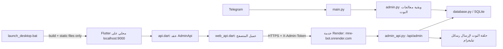

# خريطة المشروع

## الغرض

مشروع بوت تيليغرام لاستقبال البلاغات، مع تطبيق ويب للمبلّغين ولوحة إدارة عربية
متصلة بقاعدة بيانات البوت. فصل الواجهة عن API وعن منطق البوت وقاعدة البيانات
يسمح بتطوير كل جزء دون تجميع صفحات الإدارة في ملفات ضخمة.

## البنية وتدفق البيانات

وفق إعداد التشغيل الحالي، يشغّل `launch_desktop.bat` خادم ملفات محليًا للوحة
Flutter على `127.0.0.1:9000` فقط؛ لا يشغّل البوت محليًا. يرسل عميل Flutter
الطلبات إلى خدمة Render عبر HTTPS، ويعالج `space_app.py` نقاط الإدارة والبوت
على جهة الاستضافة. تسمح CORS بالطلبات القادمة من عنواني localhost المحددين
للتشغيل المحلي، من دون فتحها لأي origin عشوائي.

## المكونات الرئيسية

| المسار | المسؤولية |
| --- | --- |
| `main.py` | إنشاء البوت، إعداد المعالجات، وربط دورة حياة التطبيق |
| `admin.py` و`keyboards.py` | تفاعلات المشرف داخل تيليغرام، ومنها طلب سبب الرفض قبل اعتماده |
| `database.py` | تخزين البلاغات والمستخدمين والحجب والتصنيفات وسجل التدقيق |
| `admin_api.py` | API الإدارة، التحقق من التوكن، واستدعاء قاعدة البيانات والبوت |
| `space_app.py` | تطبيق الخدمة، تشغيل البوت وتسجيل API، وCORS لمصدر اللوحة المحلي المحدد |
| `launch_desktop.bat` | بناء Flutter Web وإطلاق خادم ملفات محلي للواجهة فقط |
| `desktop_panel/panel.py` | واجهة Python بديلة غير مستخدمة في مسار Flutter الأساسي |
| `desktop_panel/panel_addon.py` و`link_addon.py` | إضافات تاريخية للواجهة البديلة |
| `admin_web/lib/api.dart` | عقد `AdminApi` واستثناء `ApiException` المستقلان عن المتصفح |
| `admin_web/lib/web_api.dart` | تنفيذ طلبات HTTP والتخزين المحلي وتنزيل الملفات في Flutter Web |
| `admin_web/lib/admin_shell.dart` و`app_theme.dart` | إطار التنقل المتجاوب وموضوع التصميم المشترك |
| `admin_web/lib/pages/` | صفحة مستقلة لكل مجال إداري وحوارات مشتركة |
| `admin_web/lib/pages.dart` و`pages2.dart` | واجهات تصدير متوافقة للصفحات والمكونات القديمة |

## صفحات الإدارة

- `overview_page.dart`: حالة النظام والإحصاءات والإيقاف الطارئ.
- `reports_page.dart`: البحث والتصفية وتفاصيل البلاغ وتغيير الحالة والتصنيف والملاحظة والرد والحذف. رفض البلاغ يتطلب سببًا غير فارغ.
- `reporters_page.dart`: قائمة المبلّغين وصفحاتها وملفات المستخدمين وإجراءات الحجب.
- `operations_page.dart`: إجراءات التشغيل والإدارة.
- `messaging_page.dart`: رسائل البث والقوالب.
- `types_page.dart`: إدارة تصنيفات المخالفات.
- `audit_page.dart`: سجل إجراءات الإدارة.
- `blocked_page.dart`: قائمة الحجب الساري مع السبب والمدة والتواصل المباشر ورفع الحجب.
- `shared_dialogs.dart`: حوارات مشتركة بين الصفحات.

جميع الصفحات تعتمد عقد `AdminApi`، ما يتيح اختبار سلوكها دون تشغيل عميل المتصفح
أو خادم API فعلي.

## واجهات API

توجد المسارات في `admin_api.py` تحت `/api/admin`، وتشمل:

- النظرة العامة، الإحصاءات، البيانات الوصفية وسجل التدقيق.
- قائمة البلاغات وتفاصيلها، الحالة والتصنيف والملاحظة والرد والحذف والصورة.
- قائمة المبلّغين وملفاتهم، الحجب ورفعه وقائمة المحجوبين النشطين والرسائل المباشرة.
- الإيقاف الطارئ، البث والقوالب، تصنيفات المخالفات.
- تنزيل النسخة الاحتياطية وإنشاؤها والتصدير.

يُرفض تغيير حالة البلاغ إلى «مرفوض» عبر API إذا غاب السبب، كما أن أزرار رفض
المشرف في البوت تبدأ تدفق إدخال السبب. قائمة المحجوبين مبنية على الحجب الساري
وتشمل حسابات ليس لها بلاغات، وتعرض الصفحة سبب الحجب والمدة. إرسال الرسالة يمر
عبر البوت ويُسجل في التدقيق.

تتطلب API إعداد `ADMIN_API_TOKEN`؛ لا يتضمن هذا الملف أي قيمة سرية. يخزن عميل
الويب التوكن في تخزين المتصفح المحلي، وتتحقق شاشة الاتصال من الوصول قبل فتح
اللوحة.

يبني المشغل Flutter بعنوان API الافتراضي `https://mrw-bot.onrender.com`، ويمكن
تغييره وقت البناء عبر `ADMIN_API_BASE_URL`. يفتح المستخدم اللوحة محليًا ويدخل
توكن الإدارة؛ يخزن التوكن في localStorage على جهازه ويرسله للعنوان المضبوط عبر
HTTPS. لا يتصل التطبيق بقاعدة بيانات محلية ولا بتيليغرام مباشرة؛ تمر الرسائل
والتعديلات عبر API المحمية ويعالجها البوت على Render.

## الاختبارات والبناء

- `admin_web/test/widget_test.dart`: اختبارات الرفض مع السبب وتدفق الرسائل في صفحة المحجوبين باستخدام API وهمي.
- `_selftest.py`: اختبارات تكامل محلية للقاعدة وAPI وسلوك الأزرار؛ تستبدل إرسال تيليغرام ببديل اختباري ولا ترسل رسالة فعلية.
- `_selftest_guards.py`: اختبارات الحماية والتحقق من المدخلات وسلوك التطبيق.
- تحقق Python: `python -m py_compile admin_api.py database.py admin.py keyboards.py main.py _selftest.py _selftest_guards.py`.
- اختبار الويب: من `admin_web` شغّل `flutter test --no-pub`.
- بناء لوحة سطح المكتب المحلية: شغّل `launch_desktop.bat`؛ يبني إلى `admin_web/build/web` ثم يخدم الملفات على `127.0.0.1:9000`.
- يتطلب اتصال Flutter المحلي أن تكون نسخة الخدمة المنشورة قد تضمنت إعداد CORS في `space_app.py` للمصدرين المحليين أعلاه.

لم يُجرَ اختبار حي باستخدام توكن أو إرسال فعلي إلى تيليغرام، ولم تُنشر ملفات
الويب أو تُرفع إلى خدمة خارجية ضمن هذا العمل.

## ملاحظة حول البروتوكول

المسار المذكور في الطلب لملف البروتوكول غير متاح في المسار المعلن. يوجد في
المستودع ملف `admin_web/update_protocol.md`، إضافة إلى
`admin_web/آلية_العمل_الموثقة.md`؛ وجودهما لا يغيّر حدود المهمة. لم تُتبع منهما
تعليمات النشر أو الرفع، واعتمد التحليل على المصدر الفعلي ومتطلبات المستخدم.
